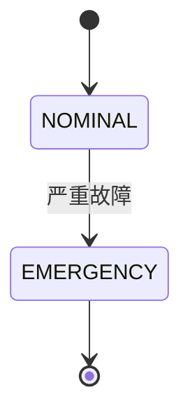

# mdToPDF

> 本项目已开源至[github](https://github.com/jianyuewushuang/mdToPDF?tab=readme-ov-file)和[gitlink](https://www.gitlink.org.cn/jianyuewushuang/mdToPDF)（国内网络友好）。

一个基于 **Pandoc + LuaLaTeX** 的中文 Markdown转PDF项目。

该项目基于[Eisvogel](https://github.com/Wandmalfarbe/pandoc-latex-template)改进而来，进行了大量中文适配。

支持六级标题分级字号、中文伪粗体/伪斜体、彩色 emoji 与特殊符号、github风格提示框、
代码高亮、表格与数学公式，适合把课程笔记、实验报告、文档直接排版成精致美观的 PDF。

## 预览


## 特性

- **六级标题分级字号**：`#` ~ `######` 逐级递减，层级清晰。
- **中文加粗 / 斜体**：通过 `AutoFakeBold` / `AutoFakeSlant` 使得无加粗和斜体的字体也可进行合成。
- **彩色 emoji 与特殊符号**：使用 `lualatex` + `mainfontfallback` ，可渲Unicode字符和彩色表情符号。
- **github风格提示框**：借助 `alerts.lua` 过滤器渲染
  `note / tip / important / warning / caution` 五种彩色提示块。
- **Mermaid 图表**：借助 `diagram.lua` 过滤器调用 mermaid-cli，
  把 ` ```mermaid ` 代码块渲染为矢量图嵌入 PDF。
- **代码高亮、表格、数学公式**：基于 Pandoc 原生支持，语法高亮风格为 `idiomatic`。
- **标题页 / 目录 / 链接着色**：通过 YAML 格式Front Matter开关控制。
- **多样式选择**：Front Matter 一行 `style: eisvogel | tikzflora` 切换版式；默认 `eisvogel`，`tikzflora` 为水彩花草页边装饰样式，且绘制参数全部可配、样式注册表可扩展。

## 目录结构

```plaintext
mdToPDF/
├── src/                          # 存放 Markdown 源文件与构建脚本
│   ├── example.md                # 默认样式示例
│   ├── example-tikzflora.md      # tikzflora 样式示例
│   ├── build_windows.ps1         # Windows 构建脚本
│   └── build_linux.sh            # Linux / macOS 构建脚本
├── build/                        # 构建产物目录，PDF 由构建脚本自动生成
├── preview/                      # 示例构建产物及其预览图
├── resources/                    # 模板与资源
│   ├── eisvogel.latex            # eisvogel 样式模板（默认）
│   ├── eisvogel.beamer           # beamer 模板
│   ├── alerts.lua                # github风格提示框 Lua 过滤器
│   ├── diagram.lua               # Mermaid 等图表的 Lua 过滤器
│   ├── flora.lua                 # tikzflora 的 flora-* 参数映射过滤器
│   ├── background.pdf            # 标题页 / 页面背景图
│   ├── styles/                   # 样式注册表：每个 .conf 对应一种样式
│   │   ├── eisvogel.conf
│   │   ├── tikzflora.conf
│   │   ├── tikzflora.latex       # tikzflora 独立模板
│   │   └── README.md             # 样式配置契约与新增样式指南
│   └── vendor/tikzflora/         # tikzflora 运行时
│       ├── LICENSE / README.md
│       ├── tikzflora.sty / tikzflora-boot.lua
│       ├── example.tex / titles.tex / latexmkrc
│       └── lua/flora/*.lua        # 含缓存、雕刻字母与四种标题页布局模块
├── package.json                  # Node 依赖声明
└── LICENSE.md                    # PolyForm Noncommercial License 1.0.0
```

## 环境要求

| 组件 | 版本 / 说明 |
| --- | --- |
| [Pandoc](https://pandoc.org/installing.html) | 安装教程可参考[我写的一篇博文](https://blog.jianyuewushuang.top/2026/05/09/pandoc%E6%8A%80%E6%9C%AF%E6%96%87%E6%A1%A3/) |
| [TeX Live](https://www.tug.org/texlive/) | 安装教程可参考[我写的另一篇博文](https://blog.jianyuewushuang.top/2026/03/26/LaTex%E6%8A%80%E6%9C%AF%E6%96%87%E6%A1%A3/) |
| [Node.js](https://nodejs.org/zh-cn) | 仅渲染 Mermaid 图表时需要。在项目根目录执行 `npm install` 即可本地安装 `@mermaid-js/mermaid-cli`（其依赖 Puppeteer 会在首次运行时自动下载 Chromium） |
| 字体 | `SimSun`、`Source Sans 3`、`Noto Color Emoji`、`FreeSans`、`DejaVu Sans` |

字体说明：`SimSun`用于中文正文；`Source Sans 3` 为西文主字体；
`Noto Color Emoji / FreeSans / DejaVu Sans` 组成 emoji 与特殊符号的回退链。

### Linux / macOS 环境补充

- **字体安装（以 Ubuntu / Debian 为例）**：

  ```bash
  sudo apt install fonts-noto-cjk fonts-noto-color-emoji \
                   fonts-freefont-ttf fonts-dejavu-core
  ```

  `Source Sans 3` 没有官方 apt 包，可从 [Adobe 官方仓库](https://github.com/adobe-fonts/source-sans)下载 TTF 放入 `~/.local/share/fonts/`（无需 root），再执行 `fc-cache -f` 刷新字体缓存。`SimSun`（宋体）是 Windows 专有字体，Linux 上没有授权时建议直接用环境变量替换：

  ```bash
  CJK_FONT="Noto Serif CJK SC" MAIN_FONT="Noto Sans" bash src/build_linux.sh
  ```

## 使用方法

### 一键构建

把 Markdown 文件放进 `src/`，然后运行构建脚本。

**Windows：**

```powershell
.\src\build_windows.ps1
```

**Linux / macOS：**

```bash
./src/build_linux.sh
```

脚本会遍历 `src/` 下所有 `*.md`，读取每个文件 Front Matter 中的 `style` 字段选择样式，逐个生成同名 `build/<name>.pdf`。

构建脚本参数：

- 输入格式：`markdown+alerts`
- 模板：由样式注册表 `resources/styles/*.conf` 决定
- 引擎：`lualatex`
- 过滤器：`resources/alerts.lua`（提示框）、`resources/diagram.lua`（Mermaid 图表），以及样式专属过滤器
- 语法高亮：`idiomatic`
- 中文主字体：`SimSun`；西文主字体：`Source Sans 3`
- emoji / 符号回退链：`Noto Color Emoji` → `FreeSans` → `DejaVu Sans`
- TeX 搜索路径：tikzflora 运行时目录由 `.conf` 声明并自动加入 `TEXINPUTS`，无需手工安装宏包

`build_linux.sh` 除上述参数外还包含以下 Linux 适配逻辑：

- **字体预检**：构建前用 `fc-list` 检查全部必需字体，缺失时直接报错并给出替代字体建议（可用 `SKIP_FONT_CHECK=1` 跳过检查）。
- **字体可覆盖**：通过环境变量修改默认字体——`CJK_FONT`（中文主字体，默认 `SimSun`）、`MAIN_FONT`（西文主字体，默认 `Source Sans 3`）、`HIGHLIGHT_STYLE`（高亮样式，默认 `idiomatic`）。
- **Mermaid 沙箱自适应**：自动探测 Chromium 沙箱是否可用，不可用时在 `build/` 下生成带 `--no-sandbox` 参数的包装脚本，无需手动干预。

### 单文件构建

日常推荐直接运行构建脚本。下面是手动调用 Pandoc 时两种样式各自的等价命令。

#### eisvogel（默认样式）

```powershell
pandoc .\src\example.md -o .\build\example.pdf `
  --from markdown+alerts `
  --template ".\resources\eisvogel.latex" `
  --syntax-highlighting idiomatic `
  --pdf-engine "lualatex" `
  -V CJKmainfont="SimSun" `
  -V mainfont="Source Sans 3" `
  -V mainfontfallback="Noto Color Emoji:mode=harf" `
  -V mainfontfallback="FreeSans:mode=harf" `
  -V mainfontfallback="DejaVu Sans:mode=harf" `
  --lua-filter ".\resources\alerts.lua" `
  --lua-filter ".\resources\diagram.lua"
```

#### tikzflora

除换模板外，还需设置 `TEXINPUTS` / `FLORA_LUA` 让临时目录中的 LuaLaTeX 找到 vendored 运行时，并追加 `--lua-filter resources/flora.lua`（负责把 `flora-*` 参数映射为 `\florasetup`）：

```powershell
$vendor = (Resolve-Path ".\resources\vendor\tikzflora").Path
$env:TEXINPUTS = "$vendor;"
$env:FLORA_LUA = "$vendor\lua"
pandoc .\src\example-tikzflora.md -o .\build\example-tikzflora.pdf `
  --from markdown+alerts `
  --template ".\resources\styles\tikzflora.latex" `
  --syntax-highlighting idiomatic `
  --pdf-engine "lualatex" `
  -V CJKmainfont="SimSun" `
  -V mainfont="Source Sans 3" `
  -V mainfontfallback="Noto Color Emoji:mode=harf" `
  -V mainfontfallback="FreeSans:mode=harf" `
  -V mainfontfallback="DejaVu Sans:mode=harf" `
  --lua-filter ".\resources\alerts.lua" `
  --lua-filter ".\resources\diagram.lua" `
  --lua-filter ".\resources\flora.lua"
```

> [!NOTE]
> 单文件构建时若文档含 Mermaid 图表，需要先让过滤器找到 mermaid-cli：
> `$env:MERMAID_BIN = ".\node_modules\.bin\mmdc.cmd"`（直接运行 `build_windows.ps1` 无需手动设置，脚本已内置）。

Linux / macOS 下对应的 bash 命令：

```bash
export MERMAID_BIN="$(pwd)/node_modules/.bin/mmdc"

# eisvogel（默认样式）
pandoc src/example.md -o build/example.pdf \
  --from markdown+alerts \
  --template resources/eisvogel.latex \
  --syntax-highlighting idiomatic \
  --pdf-engine lualatex \
  -V CJKmainfont="SimSun" \
  -V mainfont="Source Sans 3" \
  -V mainfontfallback="Noto Color Emoji:mode=harf" \
  -V mainfontfallback="FreeSans:mode=harf" \
  -V mainfontfallback="DejaVu Sans:mode=harf" \
  --lua-filter resources/alerts.lua \
  --lua-filter resources/diagram.lua

# tikzflora
vendor="$(pwd)/resources/vendor/tikzflora"
export TEXINPUTS="$vendor:"
export FLORA_LUA="$vendor/lua"
pandoc src/example-tikzflora.md -o build/example-tikzflora.pdf \
  --from markdown+alerts \
  --template resources/styles/tikzflora.latex \
  --syntax-highlighting idiomatic \
  --pdf-engine lualatex \
  -V CJKmainfont="SimSun" \
  -V mainfont="Source Sans 3" \
  -V mainfontfallback="Noto Color Emoji:mode=harf" \
  -V mainfontfallback="FreeSans:mode=harf" \
  -V mainfontfallback="DejaVu Sans:mode=harf" \
  --lua-filter resources/alerts.lua \
  --lua-filter resources/diagram.lua \
  --lua-filter resources/flora.lua
```

> [!NOTE]
> Pandoc 低于 3.6 时没有 `--syntax-highlighting` 参数，请把 `--syntax-highlighting idiomatic` 换成 `--highlight-style=tango`（或直接省略使用默认高亮）。直接运行 `build_linux.sh` 无需关心此差异，脚本会自动兼容。

## 编写 Markdown

### Front Matter

在 `.md` 文件顶部用 YAML 块设置标题、作者、目录、标题页等：

```markdown
---
style: eisvogel            # 样式：eisvogel（默认）或 tikzflora
title: "标题"
author: [你的名字]
date: "2026-09-12"
subject: "Markdown"
keywords: [关键词, markdown]
subtitle: "副标题"
titlepage: true            # 启用封面页
titlepage-rule-color: "00727c"
titlepage-background: "<绝对路径>"   # 标题页背景
page-background: "<绝对路径>"        # 正文页背景
colorlinks: true          # 链接着色
block-headings: true      # 标题独占一行
toc: true                 # 目录
toc-own-page: true        # 目录单独成页
---
```

> [!NOTE]
> 在测试时发现背景使用绝对路径无法正常构建，如有其他疑问，欢迎在Issues板块讨论。

#### `style: tikzflora`

该样式使用独立模板 `resources/styles/tikzflora.latex`，完整保留中文适配、提示框、代码块、封面、目录、链接着色等全部特性，页面样式参考上游示例 `example.tex`：

| 页面 | 效果 |
| --- | --- |
| 封面 | 见下方五种标题页布局；文字按 `title` / `subtitle` / `author` / `date` 依次填入原版排版的行 |
| 目录 | `layout=surround`，环绕花环，独占一页时无页眉页脚 |
| 正文 | 默认 `layout=split`，花草沿奇数页右侧 / 偶数页左侧外边距生长（tikzflora 原样，区分左右页） |
| 页眉页脚 | 外侧（偶数页左 / 奇数页右）小型大写标题与页码，**无分隔横线**；封面与独占一页的目录无页眉页脚 |
| 留白 | 由 `tikzflora` 的 shipout 钩子自动测量，花草会长进 `\vspace` 等空白区域 |

**五种标题页布局**：`flora-title-layout` 可选 `title` / `flank` / `wreath` / `bouquet` / `scrollwork`，默认 `flank`（跟随新版 `example.tex`）。每种按 tikzflora 原版文档复刻行数、字号、间距与 `\floraletters` 雕刻字母样式：`title` 取自 `example.tex` 的冠饰封面，其余四种取自 `titles.tex`。原版里的英文示例文字不保留，标题行依次取 `title` → `subtitle` → `author` → `date`；字段缺失时该行留白、排版骨架不变。

| 取值 | 效果 |
| --- | --- |
| `title` | 两株花草在标题上方合成冠饰，下方引文式小字块 |
| `flank` | 两株沿页面两侧上升、根部在页脚汇合（默认） |
| `wreath` | 开放的椭圆花环绕住标题 |
| `bouquet` | 一束直立花束，每行标题落在丝带上 |
| `scrollwork` | 椭圆鎏金卷草框，顶部冠饰、花草缠绕其上 |

`flora-title-letters: false` 可关闭雕刻字母（中文标题因缺少字形轮廓会自动回退为普通文字并在日志给出提示，不影响编译）；`flora-title-ornaments` 可按位置加权装饰件。

**按需居中**：默认 `layout=split` + `twoside` + `inner/outer` 不对称边距，保持 tikzflora 原样的左右页区分；当 `flora-layout` 为居中类布局（`centered` / `surround` / `title` / `flank` / `wreath` / `bouquet` / `scrollwork`）时，模板自动改用对称边距 `left=right=4.6cm`，文字块在每一页都固定在页面正中，花草左右对称生长，奇偶页位置完全一致。若同时写了 `geometry:`，以用户显式值为最高优先级，不再自动切换。

默认参数取自示例：`layout=split, seed=3, visitors=0.6`，`title` / `flank` 封面默认 `ornaments={sun_crest=6, cul_de_lampe=3}`（其余三种沿用 tikzflora 默认权重），目录默认 `layout=surround`。header 标记、cartouche 星图框、pendant 页脚角饰、gilt 金饰等装饰件默认全部启用；花草装饰边框由 layout 自动绘制，不额外添加矩形框线。所有参数都可在 Front Matter 中逐项覆盖：

```yaml
---
style: tikzflora
title: "花草样式"
subtitle: "水彩花草页边装饰"
author: [作者]
date: "2026-11-05"
titlepage: true
toc: true
toc-own-page: true

flora-layout: centered        # left / right / centered / split / title / surround
                              # flank / wreath / bouquet / scrollwork
                              # 居中类布局会自动启用对称边距
flora-header: "Florilegium"   # 外侧页眉文字，省略时取 title
flora-title-layout: bouquet   # title / flank / wreath / bouquet / scrollwork（默认 flank）
flora-title-letters: false    # 关闭雕刻体大写字母（默认开启）
flora-title-ornaments: "sun_crest=6, cul_de_lampe=3"
flora-toc-layout: surround    # 目录页编排（仅该页生效）
flora-backdrop: dark          # light（默认）/ dark / #rrggbb 深色
flora-cache: false            # 关闭页面缓存（默认开启）
flora-seed: 3                # 数值或 random（random 会使多轮编译结果不稳定，不推荐）
flora-density: 0.8           # 0~10，疏密
flora-visitors: 0.6          # 0~10，蜜蜂/蝴蝶/鸟/蜗牛权重
flora-colourway: autumn      # spring / summer / autumn / winter / ember / plum / rose / original
flora-spin: 2                # 非负整数，重选随机墨色
flora-gilt: raster           # raster / vector
flora-giltdpi: 600           # 50~1200
flora-giltenv: studio        # studio / mirror
flora-mix: "lily=2, umbel=2, feather=2, fan=2"  # 花草 / 叶形 / 花型权重
flora-palette: "leaves=green, blooms=warm"      # 各部位墨色
flora-ornaments: "sun_crest=6, cul_de_lampe=3" # 各位置装饰权重
flora-giltlook: "horizon=0.1, grain=0"          # 光栅金饰外观
flora-setup: "spin=2"        # 逃生口：原样追加一条 \florasetup，便于使用未来新增的键
---
```

要点：

- 带花括号的键（`flora-mix` / `flora-palette` / `flora-ornaments` / `flora-giltlook`）写成纯字符串 `k=v, k=v`，由 `resources/flora.lua` 包裹成 `key={...}`；值中**不要**自己写花括号、引号、换行或 LaTeX 命令，非法字符会直接报错并指出键名。`flora-header` 同样接受纯文本。
- 新版 `flora-mix` 还支持叶形 `feather` / `acanthus` / `lance` 与花型 `fan` / `round`；`flora-ornaments` 的 `crest` 位置新增 `wreath`。
- `flora-backdrop` 只接受 `light` / `dark` / 深色 `#rrggbb`；`dark` 或自定义颜色时模板自动加深色页面底色并把正文设为白字，花草墨色由 tikzflora 自行反相。代码块、提示框等仍沿用 eisvogel 的浅色配色，暗色模式下需自行调整。
- 新版运行时默认启用页面缓存（`<jobname>-flora/`，位于 `build/` 下且已被忽略），Pandoc 多轮编译时复用未改动的页面；`flora-cache: false` 可关闭。加载 `tikzflora` 时还会把 PDF 压缩级别降到 4 以加快编译，可在 `header-includes` 中设置 `\pdfvariable compresslevel=9` 换取更小的文件。
- 参数映射由 `flora.lua` 以原始 LaTeX 注入 preamble，位于模板默认值之后，因此用户值覆盖默认值（tikzflora 的 `\florasetup` 按键合并）。`flora-setup` 中的 `layout=` 优先级高于 `flora-layout`。
- 封面 / 目录的 `flora-title-*` / `flora-toc-*` 通过 `\florathispage` 只对**下一次输出的那一页**生效，优先级高于全局 `flora-*`；它们不参与全局边距判定，目录若跨页，仅首页有花环。
- `flora-*` 仅对 `tikzflora` 生效，eisvogel 文档中的同名字段会被忽略。
- 该样式不使用 eisvogel 的标题页排版，因此以下字段在 tikzflora 下**不生效**：`titlepage-rule-color`、`titlepage-rule-height`、`titlepage-text-color`、`titlepage-background`、`titlepage-color`、`titlepage-logo`、`header-left` / `header-right` / `header-center`、`footer-left` / `footer-right` / `footer-center`。正文页背景 `page-background` 仍可用。
- 键名与取值范围以上游 [tikz-flora 指南](https://flora.alpacasoft.dev) 为准；项目内附带的运行时位于 `resources/vendor/tikzflora/`。

> [!WARNING]
> `centered` 等居中布局、以及 `wreath` / `bouquet` / `scrollwork` 标题页每页绘制两株花草，PGF 对象数明显增加，叠加 Pandoc 为目录/交叉引用的多轮 LuaLaTeX 编译，耗时与 PDF 体积会上升。长文档建议 `flora-gilt: vector`、降低 `flora-giltdpi`、调低 `flora-density` / `flora-visitors`，保留默认缓存，或显式改用 `flora-layout: left` / `right`。

### github风格提示框

使用 GitHub 风格的 `> [!TYPE]` 引用语法，由 `alerts.lua` 渲染为彩色块：

```markdown
> [!NOTE]
> 说明
```

> [!NOTE]
> 说明

```markdown
> [!TIP]
> 技巧
```

> [!TIP]
> 技巧

```markdown
> [!IMPORTANT]
> 重要
```

> [!IMPORTANT]
> 重要

```markdown
> [!WARNING]
> 警告
```

> [!WARNING]
> 警告

```markdown
> [!CAUTION]
> 危险
```

> [!CAUTION]
> 危险

### Mermaid 图表

在代码块中使用 `mermaid` 语言标记，`diagram.lua` 过滤器会调用
[mermaid-cli](https://github.com/mermaid-js/mermaid-cli) 把图表渲染为矢量 PDF 并嵌入文档，
流程图、时序图、状态图、甘特图等 [Mermaid 支持的图形](https://mermaid.js.org/syntax/flowchart.html)均可：

````markdown

````

**首次使用前安装依赖**（需要 Node.js / npm）：

```powershell
npm install
```

依赖以项目本地方式安装（位于 `node_modules/`，不会写入全局环境）。
mermaid-cli 依赖 Puppeteer，首次运行时会自动下载一份 Chromium 到用户缓存目录。

## 自定义

- **改模板**：eisvogel 编辑 `resources/eisvogel.latex`，tikzflora 编辑 `resources/styles/tikzflora.latex`（标题字号、字体、配色、页眉页脚等）。
- **改 tikzflora 绘制参数**：优先用 Front Matter 的 `flora-*` 键；要改默认值可编辑 `resources/styles/tikzflora.latex` 中带 `TIKZFLORA ADAPTATIONS` 标记的段落。
- **改github风格提示框样式**：编辑 `resources/alerts.lua`（颜色、边框、标题文案）。
- **改图表渲染**：编辑 `resources/diagram.lua`；除 mermaid 外它还内置 plantuml、graphviz、tikz、d2 等引擎，安装对应可执行文件后以同名代码块即可使用。
- **改构建流程**：Windows 编辑 `src/build_windows.ps1`，Linux / macOS 编辑 `src/build_linux.sh`。
- **参考上游**：Eisvogel 见[上游项目](https://github.com/Wandmalfarbe/pandoc-latex-template)；tikzflora 见[官方指南](https://flora.alpacasoft.dev)。

### 新增一个样式

样式由 `resources/styles/*.conf` 注册表驱动，**新增样式不需要修改构建脚本主逻辑**：

1. 在 `resources/styles/` 下新建 `<name>.latex` 模板。
2. 若需要第三方 TeX 运行时，放进 `resources/vendor/<name>/` 并在 `.conf` 里用 `TEXINPUTS` 声明目录。
3. 新建 `<name>.conf`，至少写 `TEMPLATE=resources/styles/<name>.latex`；可选 `LUA_FILTERS`（样式专属过滤器）、`ENV_<VAR>`（额外环境变量）、`PANDOC_ARGS`（额外 pandoc 参数）。所有路径都相对项目根，脚本会拼成绝对路径。
4. 加一个 `src/example-<name>.md` 示例，并在中英文 README 补充该样式的专有参数。

## LICENSE

本项目基于 [PolyForm Noncommercial License 1.0.0](LICENSE.md) 发布。

> Required Notice: Copyright 2026 jianyuewushuang <jianyuewushuang@163.com>

非商业用途可自由使用、修改与分发；如需商业用途请联系作者。
