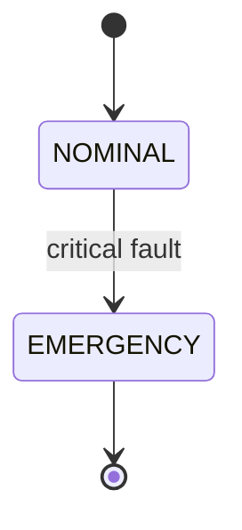

# mdToPDF

> This project is open-sourced on [github](https://github.com/jianyuewushuang/mdToPDF?tab=readme-ov-file) and [gitlink](https://www.gitlink.org.cn/jianyuewushuang/mdToPDF).

A Chinese Markdown-to-PDF project based on **Pandoc + LuaLaTeX**.

This project is derived from and heavily adapted for Chinese from [Eisvogel](https://github.com/Wandmalfarbe/pandoc-latex-template).

It supports a graded six-level heading scale, Chinese fake-bold / fake-italic, colorful emoji and special symbols, GitHub-style admonitions, code highlighting, tables and math formulas — ideal for turning course notes, lab reports and documents into polished, good-looking PDFs.

## Preview


## Features

- **Graded six-level heading scale**: `#` to `######` step down in size, with a clear hierarchy.
- **Chinese bold / italic**: `AutoFakeBold` / `AutoFakeSlant` allow synthesizing bold and italic even for fonts that lack them.
- **Colorful emoji and special symbols**: uses `lualatex` + `mainfontfallback` to render Unicode characters and colorful emojis.
- **GitHub-style admonitions**: the `alerts.lua` filter renders five colored callout blocks — `note / tip / important / warning / caution`.
- **Mermaid diagrams**: the `diagram.lua` filter calls mermaid-cli to render ` ```mermaid ` code blocks into vector images embedded in the PDF.
- **Code highlighting, tables, math formulas**: native Pandoc support, with the `idiomatic` syntax-highlighting style.
- **Title page / TOC / colored links**: controlled via YAML Front Matter switches.
- **Selectable styles**: one line in Front Matter, `style: eisvogel | tikzflora`, switches the layout. `eisvogel` is the default; `tikzflora` adds watercolour botanical margins, with every drawing parameter configurable and an extensible style registry.

## Directory Structure

```plaintext
mdToPDF/
├── src/                              # Markdown sources and build scripts
│   ├── example.md                    # Default style example
│   ├── example-tikzflora.md          # tikzflora style example
│   ├── build_windows.ps1             # Windows build script
│   └── build_linux.sh                # Linux / macOS build script
├── build/                            # Build output; PDFs are generated by the scripts
├── preview/                          # Sample output and preview images
├── resources/                        # Templates and resources
│   ├── eisvogel.latex                # eisvogel style template (default)
│   ├── eisvogel.beamer               # beamer template
│   ├── alerts.lua                    # GitHub-style admonition Lua filter
│   ├── diagram.lua                   # Mermaid and other diagram Lua filter
│   ├── flora.lua                     # tikzflora flora-* parameter mapping filter
│   ├── background.pdf                # Title-page / page background image
│   ├── styles/                       # Style registry: one .conf per style
│   │   ├── eisvogel.conf
│   │   ├── tikzflora.conf
│   │   ├── tikzflora.latex           # Standalone tikzflora template
│   │   └── README.md                 # Config contract and how to add a style
│   └── vendor/tikzflora/             # tikzflora runtime
│       ├── LICENSE / README.md
│       ├── tikzflora.sty / tikzflora-boot.lua
│       ├── example.tex / titles.tex / latexmkrc
│       └── lua/flora/*.lua            # page cache, engraved letters, title layouts
├── package.json                      # Node dependency manifest
└── LICENSE.md                        # PolyForm Noncommercial License 1.0.0
```

## Requirements

| Component | Version / Notes |
| --- | --- |
| [Pandoc](https://pandoc.org/installing.html) | refer to [one of my blog post](https://blog.jianyuewushuang.top/2026/05/09/pandoc%E6%8A%80%E6%9C%AF%E6%96%87%E6%A1%A3/) for the installation |
| [TeX Live](https://www.tug.org/texlive/) | refer to [my another blog post](https://blog.jianyuewushuang.top/2026/03/26/LaTex%E6%8A%80%E6%9C%AF%E6%96%87%E6%A1%A3/) for the installation |
| [Node.js](https://nodejs.org/) | only required for rendering Mermaid diagrams. Run `npm install` in the project root to locally install `@mermaid-js/mermaid-cli` (its Puppeteer dependency automatically downloads Chromium on first run) |
| Fonts | `SimSun`, `Source Sans 3`, `Noto Color Emoji`, `FreeSans`, `DejaVu Sans` |

Font notes: `SimSun` is used for Chinese body text; `Source Sans 3` is the Latin main font; `Noto Color Emoji / FreeSans / DejaVu Sans` form the emoji and special-symbol fallback chain.

### Linux / macOS notes

- **Pandoc version**: `--syntax-highlighting idiomatic` requires Pandoc 3.6 or newer. `build_linux.sh` detects the installed version automatically and falls back to `--highlight-style` (and to the default style when `idiomatic` is unavailable) on older releases.
- **Fonts (Ubuntu / Debian example)**:

  ```bash
  sudo apt install fonts-noto-cjk fonts-noto-color-emoji \
                   fonts-freefont-ttf fonts-dejavu-core
  ```

  `Source Sans 3` is not packaged in the official apt repositories. Download the TTFs from the [Adobe repository](https://github.com/adobe-fonts/source-sans), place them under `~/.local/share/fonts/` (no root required) and run `fc-cache -f` to refresh the font cache. `SimSun` is a proprietary Windows font; on Linux without a license you can replace both fonts through environment variables:

  ```bash
  CJK_FONT="Noto Serif CJK SC" MAIN_FONT="Noto Sans" bash src/build_linux.sh
  ```

- **Mermaid in containers / CI**: some Linux distributions (e.g. Ubuntu 23.10+) and containers disallow unprivileged user namespaces, so the Chromium sandbox cannot start. The script probes this automatically and switches to an `--no-sandbox` compatibility mode (only use it for rendering your own trusted diagrams) — no manual configuration required.

## Usage

### One-shot build

Put your Markdown files into `src/`, then run the build script.

**Windows (PowerShell):**

```powershell
.\src\build_windows.ps1
```

**Linux / macOS (bash):**

```bash
bash src/build_linux.sh

# or make it executable and run it directly
chmod +x src/build_linux.sh
./src/build_linux.sh
```

The script iterates over every `*.md` in `src/`, reads its Front Matter `style` field to pick a style, and produces a matching `build/<name>.pdf` for each.

Build script parameters:

- Input format: `markdown+alerts`
- Template: resolved from the style registry `resources/styles/*.conf`
- Engine: `lualatex`
- Filters: `resources/alerts.lua` (admonitions), `resources/diagram.lua` (Mermaid diagrams), plus style-specific filters
- Syntax highlighting: `idiomatic`
- Chinese main font: `SimSun`; Latin main font: `Source Sans 3`
- emoji / symbol fallback chain: `Noto Color Emoji` → `FreeSans` → `DejaVu Sans`
- TeX search path: the tikzflora runtime directory is declared in its `.conf` and added to `TEXINPUTS` automatically — no manual package installation needed

In addition to the parameters above, `build_linux.sh` adds the following Linux-specific logic:

- **Font preflight**: every required font is checked with `fc-list` before building; the script aborts with a clear message and substitution suggestions when a font is missing (skip with `SKIP_FONT_CHECK=1`).
- **Overridable fonts**: the defaults can be changed with environment variables — `CJK_FONT` (Chinese main font, default `SimSun`), `MAIN_FONT` (Latin main font, default `Source Sans 3`), `HIGHLIGHT_STYLE` (highlight style, default `idiomatic`).
- **Mermaid sandbox auto-detection**: it probes whether the Chromium sandbox works and generates an `--no-sandbox` wrapper under `build/` when it does not — no manual intervention needed.

### Single-file build

Running the build scripts is recommended. Below are the equivalent manual Pandoc commands for both styles.

#### eisvogel (default)

```powershell
pandoc .\src\example.md -o .\build\example.pdf `
  --from markdown+alerts `
  --template ".\resources\eisvogel.latex" `
  --syntax-highlighting idiomatic `
  --pdf-engine "lualatex" `
  -V CJKmainfont="SimSun" `
  -V mainfont="Source Sans 3" `
  -V mainfontfallback="Noto Color Emoji:mode=harf" `
  -V mainfontfallback="FreeSans:mode=harf" `
  -V mainfontfallback="DejaVu Sans:mode=harf" `
  --lua-filter ".\resources\alerts.lua" `
  --lua-filter ".\resources\diagram.lua"
```

#### tikzflora

Besides the template, set `TEXINPUTS` / `FLORA_LUA` so LuaLaTeX (running in a temporary directory) can find the vendored runtime, and add `resources/flora.lua`, which maps `flora-*` keys to `\florasetup`:

```powershell
$vendor = (Resolve-Path ".\resources\vendor\tikzflora").Path
$env:TEXINPUTS = "$vendor;"
$env:FLORA_LUA = "$vendor\lua"
pandoc .\src\example-tikzflora.md -o .\build\example-tikzflora.pdf `
  --from markdown+alerts `
  --template ".\resources\styles\tikzflora.latex" `
  --syntax-highlighting idiomatic `
  --pdf-engine "lualatex" `
  -V CJKmainfont="SimSun" `
  -V mainfont="Source Sans 3" `
  -V mainfontfallback="Noto Color Emoji:mode=harf" `
  -V mainfontfallback="FreeSans:mode=harf" `
  -V mainfontfallback="DejaVu Sans:mode=harf" `
  --lua-filter ".\resources\alerts.lua" `
  --lua-filter ".\resources\diagram.lua" `
  --lua-filter ".\resources\flora.lua"
```

> [!NOTE]
> If your document contains Mermaid diagrams, the single-file command needs the filter to find mermaid-cli first:
> `$env:MERMAID_BIN = ".\node_modules\.bin\mmdc.cmd"` (no manual setup is needed when running `build_windows.ps1`, which already sets it).

Equivalent bash commands on Linux / macOS:

```bash
export MERMAID_BIN="$(pwd)/node_modules/.bin/mmdc"

# eisvogel (default)
pandoc src/example.md -o build/example.pdf \
  --from markdown+alerts \
  --template resources/eisvogel.latex \
  --syntax-highlighting idiomatic \
  --pdf-engine lualatex \
  -V CJKmainfont="SimSun" \
  -V mainfont="Source Sans 3" \
  -V mainfontfallback="Noto Color Emoji:mode=harf" \
  -V mainfontfallback="FreeSans:mode=harf" \
  -V mainfontfallback="DejaVu Sans:mode=harf" \
  --lua-filter resources/alerts.lua \
  --lua-filter resources/diagram.lua

# tikzflora
vendor="$(pwd)/resources/vendor/tikzflora"
export TEXINPUTS="$vendor:"
export FLORA_LUA="$vendor/lua"
pandoc src/example-tikzflora.md -o build/example-tikzflora.pdf \
  --from markdown+alerts \
  --template resources/styles/tikzflora.latex \
  --syntax-highlighting idiomatic \
  --pdf-engine lualatex \
  -V CJKmainfont="SimSun" \
  -V mainfont="Source Sans 3" \
  -V mainfontfallback="Noto Color Emoji:mode=harf" \
  -V mainfontfallback="FreeSans:mode=harf" \
  -V mainfontfallback="DejaVu Sans:mode=harf" \
  --lua-filter resources/alerts.lua \
  --lua-filter resources/diagram.lua \
  --lua-filter resources/flora.lua
```

> [!NOTE]
> Pandoc older than 3.6 has no `--syntax-highlighting` flag — replace `--syntax-highlighting idiomatic` with `--highlight-style=tango` (or drop the flag to use the default). You do not need to worry about this when running `build_linux.sh`, which handles the difference automatically.

## Writing Markdown

### Front Matter

Set the title, author, table of contents, title page, etc. with a YAML block at the top of your `.md` file:

```markdown
---
style: eisvogel            # Style: eisvogel (default) or tikzflora
title: "标题"
author: [你的名字]
date: "2026-09-12"
subject: "Markdown"
keywords: [关键词, markdown]
subtitle: "副标题"
titlepage: true            # Enable the cover page
titlepage-rule-color: "00727c"
titlepage-background: "<absolute path>"   # Title-page background
page-background: "<absolute path>"        # Body-page background
colorlinks: true          # Color hyperlinks
block-headings: true      # Headings occupy their own line
toc: true                 # Table of contents
toc-own-page: true        # TOC on its own page
---
```

> [!NOTE]
> During testing we found that using an absolute path for the background prevents a successful build. For any other questions, feel free to discuss them in the Issues section.

#### `style: tikzflora`

This style uses the standalone template `resources/styles/tikzflora.latex`. It keeps every existing feature (Chinese font adaptation, admonitions, code highlighting, cover page, TOC, colored links, …) and follows the page styling of the upstream `example.tex`:

| Page | Effect |
| --- | --- |
| Cover | One of the five title-page layouts below; its display lines take `title` / `subtitle` / `author` / `date` in order |
| Contents | `layout=surround`: a wreath around the text block; no running head when the TOC owns its page |
| Body | Default `layout=split`: flora grows in the outer margin, right on odd pages and left on even pages (tikzflora's original two-sided look) |
| Header / footer | Outer-side (even-page left, odd-page right) small-caps text and page number, **no rules**; the cover and a standalone TOC have no header or footer |
| Whitespace | tikzflora's shipout hook measures the shipped page, so flora grows into gaps such as `\vspace` |

**Five title-page layouts**: `flora-title-layout` accepts `title` / `flank` / `wreath` / `bouquet` / `scrollwork`, defaulting to `flank`. Each reproduces the line counts, sizes, spacing and `\floraletters` engraved capitals of its upstream document: `title` from `example.tex`, the other four from `titles.tex`. None of the fixed English sample wording is kept — the display lines take `title` → `subtitle` → `author` → `date` in order, and a missing field leaves its line blank while the spacing skeleton stays.

| Value | Effect |
| --- | --- |
| `title` | Two plants meeting in a crown above the title, with a small quotation-like block below |
| `flank` | A plant up each side, their roots meeting at the foot (default) |
| `wreath` | An open oval garland around the title |
| `bouquet` | One upright bouquet, each title line on a ribbon |
| `scrollwork` | An oval gilt scroll frame with a crest at its head and flora twined over it |

`flora-title-letters: false` turns the engraved capitals off (CJK titles fall back to ordinary text with a log warning because the font outlines are unavailable, which does not break the build); `flora-title-ornaments` weights ornaments by place.

**Centring on demand**: by default the document stays two-sided with asymmetric `inner/outer` margins and `layout=split`, exactly as in tikzflora. When `flora-layout` is a centring layout (`centered` / `surround` / `title` / `flank` / `wreath` / `bouquet` / `scrollwork`), the template automatically switches to symmetric margins (`left=right=4.6cm`): the text block sits in the same centred position on every page and flora grows symmetrically on both sides. An explicit `geometry:` in Front Matter has the highest priority and disables the automatic switch.

Defaults follow the upstream example: `layout=split, seed=3, visitors=0.6`; `title` / `flank` covers use `ornaments={sun_crest=6, cul_de_lampe=3}` (the other three keep tikzflora's default weights), and the contents page uses `layout=surround`. Header marks, cartouche panels, foot pendants and gilt are all enabled at their default weights; the decorative border is drawn by the layout itself, with no extra rectangular frame. Every parameter can be overridden in Front Matter:

```yaml
---
style: tikzflora
title: "Flora"
subtitle: "Watercolour botanical margins"
author: [Author]
date: "2026-11-05"
titlepage: true
toc: true
toc-own-page: true

flora-layout: centered        # left / right / centered / split / title / surround
                              # flank / wreath / bouquet / scrollwork
                              # centring layouts also enable symmetric margins
flora-header: "Florilegium"   # outer running-head text; defaults to title
flora-title-layout: bouquet   # title / flank / wreath / bouquet / scrollwork (default flank)
flora-title-letters: false    # turn engraved display capitals off (on by default)
flora-title-ornaments: "sun_crest=6, cul_de_lampe=3"
flora-toc-layout: surround    # contents-page staging (that page only)
flora-backdrop: dark          # light (default) / dark / a dark #rrggbb
flora-cache: false            # disable the per-page cache (on by default)
flora-seed: 3                # number or random (random makes multi-pass output unstable, not recommended)
flora-density: 0.8           # 0-10, how full the border grows
flora-visitors: 0.6          # 0-10, weight of bees / butterflies / birds / snails
flora-colourway: autumn      # spring / summer / autumn / winter / ember / plum / rose / original
flora-spin: 2                # non-negative integer, re-picks random inks
flora-gilt: raster           # raster / vector
flora-giltdpi: 600           # 50-1200
flora-giltenv: studio        # studio / mirror
flora-mix: "lily=2, umbel=2, feather=2, fan=2"  # growth / leaf-shape / bloom-style weights
flora-palette: "leaves=green, blooms=warm"      # ink per part
flora-ornaments: "sun_crest=6, cul_de_lampe=3" # weights per ornament kind
flora-giltlook: "horizon=0.1, grain=0"          # raster gilt look
flora-setup: "spin=2"        # escape hatch: one extra raw \florasetup, useful for future keys
---
```

Notes:

- Map-like keys (`flora-mix`, `flora-palette`, `flora-ornaments`, `flora-giltlook`) are plain `k=v, k=v` strings; `resources/flora.lua` wraps them as `key={...}`. Do **not** include braces, quotes, newlines or LaTeX commands — invalid values fail the build with the offending key name. `flora-header` takes plain text too.
- The updated `flora-mix` also accepts the leaf shapes `feather` / `acanthus` / `lance` and bloom styles `fan` / `round`; the `crest` place of `flora-ornaments` gained `wreath`.
- `flora-backdrop` accepts only `light` / `dark` / a dark `#rrggbb`. For `dark` or a custom colour the template sets a matching dark page colour and white body text; tikzflora repaints its inks for the dark ground. Code blocks and admonitions keep eisvogel's light palette, so they may need manual adjustment in dark mode.
- The updated runtime caches each page's flora in `<jobname>-flora/` (under `build/`, gitignored) so Pandoc's reruns reuse unchanged pages; `flora-cache: false` disables it. Loading `tikzflora` also lowers the PDF compression level to 4 for faster builds — set `\pdfvariable compresslevel=9` via `header-includes` for a smaller file.
- The mapping is injected as raw LaTeX into the preamble *after* the template defaults, so user values win (tikzflora merges keys on each `\florasetup` call). A `layout=` inside `flora-setup` takes precedence over `flora-layout`.
- `flora-title-*` / `flora-toc-*` use `\florathispage`, which affects only the **next shipped page** and takes precedence over the global `flora-*` values. They do not affect the global margin decision. If the TOC spans several pages, only its first page gets the wreath.
- `flora-*` keys apply only to `tikzflora`; they are ignored in eisvogel documents.
- This style does not use eisvogel's title-page layout, so the following keys have **no effect** under tikzflora: `titlepage-rule-color`, `titlepage-rule-height`, `titlepage-text-color`, `titlepage-background`, `titlepage-color`, `titlepage-logo`, `header-left` / `header-right` / `header-center`, and `footer-left` / `footer-right` / `footer-center`. The body-page `page-background` key still works.
- See the upstream [tikz-flora guide](https://flora.alpacasoft.dev) for all key names and value ranges; the bundled runtime lives in `resources/vendor/tikzflora/` .

> [!WARNING]
> Centring layouts and the `wreath` / `bouquet` / `scrollwork` title pages draw two plants per page, and Pandoc reruns LuaLaTeX several times for the TOC and cross-references, so build time and PDF size grow noticeably. For long documents prefer `flora-gilt: vector`, a lower `flora-giltdpi`, smaller `flora-density` / `flora-visitors`, keep the cache enabled, or use an explicit `flora-layout: left` / `right`.

### GitHub-style admonitions

Use the GitHub-style `> [!TYPE]` blockquote syntax; `alerts.lua` renders it as a colored block:

```markdown
> [!NOTE]
> Explanation
```

> [!NOTE]
> Explanation

```markdown
> [!TIP]
> Tip
```

> [!TIP]
> Tip

```markdown
> [!IMPORTANT]
> Important
```

> [!IMPORTANT]
> Important

```markdown
> [!WARNING]
> Warning
```

> [!WARNING]
> Warning

```markdown
> [!CAUTION]
> Danger
```

> [!CAUTION]
> Danger

### Mermaid diagrams

Use a code block with the `mermaid` language tag; the `diagram.lua` filter calls
[mermaid-cli](https://github.com/mermaid-js/mermaid-cli) to render the diagram as a vector PDF embedded in the document.
Flowcharts, sequence diagrams, state diagrams, Gantt charts and every other
[diagram type supported by Mermaid](https://mermaid.js.org/syntax/flowchart.html) work:

````markdown

````

**Install the dependency before first use** (Node.js / npm required):

```powershell
npm install
```

The dependency is installed locally inside the project (`node_modules/`), nothing is written to the global environment.
mermaid-cli depends on Puppeteer, which automatically downloads a Chromium build into the user cache directory on its first run.

## Customization

- **Change the template**: edit `resources/eisvogel.latex` for eisvogel or `resources/styles/tikzflora.latex` for tikzflora (heading sizes, fonts, colors, headers/footers, etc.).
- **Change tikzflora drawing parameters**: prefer the `flora-*` Front Matter keys; to change the defaults, edit the `TIKZFLORA ADAPTATIONS` blocks in `resources/styles/tikzflora.latex`.
- **Change GitHub-style admonition styles**: edit `resources/alerts.lua` (colors, borders, title text).
- **Change diagram rendering**: edit `resources/diagram.lua`; besides mermaid it also ships with plantuml, graphviz, tikz and d2 engines — install the corresponding executable and use a code block with the matching language tag.
- **Change the build flow**: edit `src/build_windows.ps1` on Windows or `src/build_linux.sh` on Linux / macOS.
- **Reference upstream**: [Eisvogel](https://github.com/Wandmalfarbe/pandoc-latex-template) and the [tikz-flora guide](https://flora.alpacasoft.dev).

### Adding a style

Styles are driven by the `resources/styles/*.conf` registry — **adding a style does not require changing the build scripts**:

1. Create `<name>.latex` in `resources/styles/` (copying `resources/eisvogel.latex` first is the easiest way to keep all existing features).
2. If the style needs third-party TeX runtime, place it under `resources/vendor/<name>/` and declare the directory with `TEXINPUTS` in the `.conf`.
3. Create `<name>.conf` with at least `TEMPLATE=resources/styles/<name>.latex`; optionally `LUA_FILTERS` (style-specific filters), `ENV_<VAR>` (extra environment variables) and `PANDOC_ARGS` (extra Pandoc arguments). All paths are relative to the project root and are resolved to absolute paths by the scripts.
4. Add a `src/example-<name>.md` sample and document the style's parameters in both READMEs.

## LICENSE

This project is released under the [PolyForm Noncommercial License 1.0.0](LICENSE.md).

> Required Notice: Copyright 2026 jianyuewushuang <jianyuewushuang@163.com>

Noncommercial use is free to use, modify and distribute; for commercial use, please contact the author.
