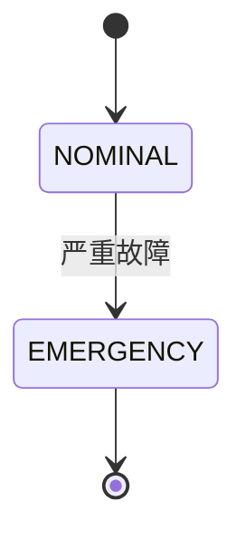

> [!NOTE]
> 本文件使用 `style: tikzflora`，页面样式参考 tikzflora 自带示例：页眉为外侧
> 小型大写文字、页脚外侧为页码，均无分隔横线；目录页有环绕花环。封面选用
> `bouquet` 标题页布局，标题文字按 title / subtitle / author / date 依次填充。
> `flora-layout: centered` 让正文文字块在每页居中、花草左右对称生长；页面
> 留白处花草也会自动填充。新版运行时默认启用页面缓存并降低 PDF 压缩级别。

## 二级标题

### 三级标题

#### 四级标题

##### 五级标题

###### 六级标题

中文正文与 **加粗**、*斜体*、***加粗斜体***。

- 无序列表
- 无序列表

\newpage

1. 有序列表
2. 有序列表

> [!TIP]
> 提示框由 `alerts.lua` 渲染，两种样式共用。

五种提示块在 tikzflora 下同样可用：

> [!WARNING]
> 警告

```python
# Python 代码块
print("Hello, World!")
```

| 项目 | 占比 |
| --- | --- |
| 期末（闭卷） | 60% |
| 平时成绩 | 40% |

$$P(\text{甲胜}) = \frac12 + \frac14 = \frac34$$

(´▽`ʃ♡ƪ)ᓚᘏᗢ😋✊😊❤✓↔−

\vspace{5cm}

> 上面留出的空白会被花草长满。




