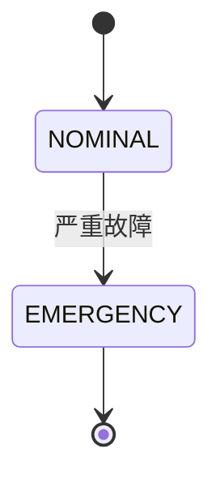

> [!NOTE]
> 本文件使用 `style: tikzflora`。封面页有冠饰与尾饰，目录页有环绕花环，
> 正文页花草沿外侧页边逐页生长，页面留白处也会自动填充。

## 二级标题

### 三级标题

#### 四级标题

##### 五级标题

###### 六级标题

中文正文与 **加粗**、*斜体*、***加粗斜体***。

- 无序列表
- 无序列表

\newpage

1. 有序列表
2. 有序列表

> [!TIP]
> 提示框由 `alerts.lua` 渲染，两种样式共用。

> [!WARNING]
> 警告

```python
# Python 代码块
print("Hello, World!")
```

| 项目 | 占比 |
| --- | --- |
| 期末（闭卷） | 60% |
| 平时成绩 | 40% |

$$P(\text{甲胜}) = \frac12 + \frac14 = \frac34$$

(´▽`ʃ♡ƪ)ᓚᘏᗢ😋✊😊❤✓↔−

\vspace{5cm}

> 上面留出的空白会被花草长满。




